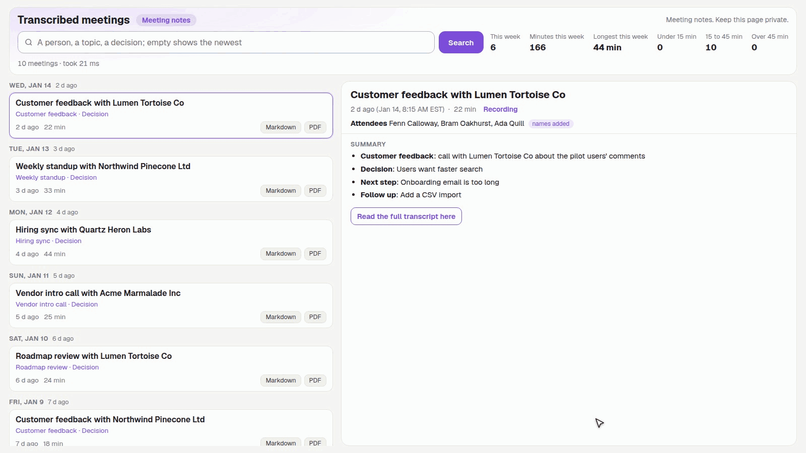
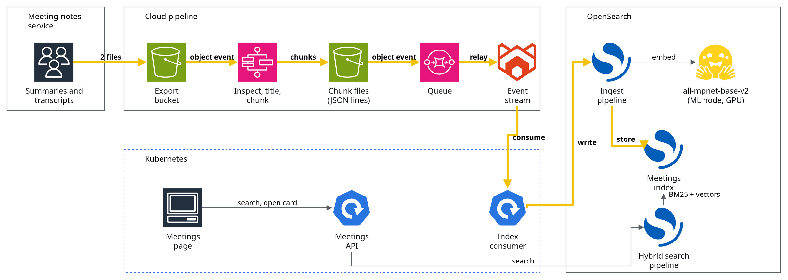

# Meeting Search

## Executive summary

Meeting Search turns the summaries and transcripts a meeting-notes service exports into one searchable card per meeting. Each meeting arrives as two files, a summary and a full transcript; they are split into chunks, embedded on a GPU, indexed in  [OpenSearch](https://opensearch.org) for hybrid search (keywords and meaning together), and folded back into a single card per meeting, newest first, so a question like "what did we decide about the roadmap" finds the meeting and the sentence.

- **Meetings** lists every meeting as one card with its summary in front, narrows the list as you type or by date range, marks the matching words in the snippet, and opens the full transcript behind the card. A card can also be exported as Markdown or PDF.

## In action

**Search the meetings and open one card.** One recording searches the list, then opens a meeting and its transcript. (Recorded on demo data.)

## Architecture

Meeting Search is a file pipeline into a search index, read by one web page. The system has four parts:

- **Data pipeline.** The meeting-notes service exports two files per meeting into  [object storage](https://aws.amazon.com/s3/).
  - An object event starts a  [Step Functions](https://aws.amazon.com/step-functions/) workflow that inspects the file, gives an untitled meeting a title with a language model, and splits the text into overlapping chunks written as JSON lines.
  - A second object event puts each chunk file on a  [queue](https://aws.amazon.com/sqs/), a  [Redpanda](https://www.redpanda.com) event stream relays it, and an index consumer on Kubernetes writes it to the index.
- **Search.**  [OpenSearch](https://opensearch.org) holds one document per chunk.
  - An ingest pipeline embeds each chunk with  [all-mpnet-base-v2](https://huggingface.co/sentence-transformers/all-mpnet-base-v2) (768 numbers per chunk) on the OpenSearch machine-learning node and stamps the meeting name and start time.
  - A hybrid search pipeline combines keyword and vector scores; a second pipeline folds chunks into one hit per meeting.
- **Web UI.** A  [React](https://vite.dev) page and a  [FastAPI](https://fastapi.tiangolo.com) backend run on Kubernetes through  [Argo CD](https://argo-cd.readthedocs.io); the backend sends the search, groups the chunks into cards and returns the meetings newest first.
- **Credentials.** Every key comes from a password manager at run time; none is in the code or the images.

## License

PolyForm Noncommercial 1.0.0 with a required notice from Haya Tech LLC. Noncommercial use is free; any commercial use, including resale, hosting for others, or a paid product, needs a written license from Haya Tech LLC first. See [LICENSE](LICENSE).
